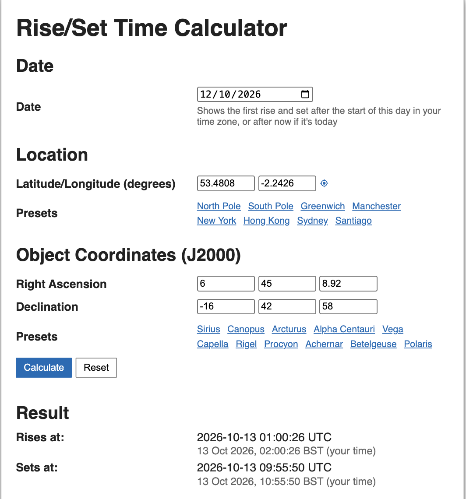

# star-rise-and-set-times

Here is a browser-based tool for calculating the rising and setting times of stars. You can [try it online here](https://codebox.net/pages/star-rise-and-set-time-calculator).



The code is based on formulae [from](https://github.com/wlandsman/IDLAstro/blob/master/pro/hadec2altaz.pro) [various](https://aa.usno.navy.mil/faq/GAST) [sources](https://astronomy.stackexchange.com/a/14508/24882), with much credit to [Barry Carter](http://wordpress.barrycarter.info) for his help and patience. The refraction and precession corrections follow Jean Meeus's *Astronomical Algorithms* (chapters 15 and 21).

Pick a date, a location and an object. The page shows the first rise and set after the start of that day in your time zone (or after the current time, if you pick today), in UTC and in your local time. Latitude is positive north of the equator and longitude is positive east of Greenwich, so New York is 40.71, -74.01.

Enter the object's coordinates for the year 2000 (J2000), as given by most star catalogues. The calculation then:

- corrects the coordinates for precession between 2000 and the chosen date, which moves them by about 50 arcseconds a year
- uses the standard value for atmospheric refraction at the horizon (34 arcminutes), so the times are when the object appears to rise and set, not when it crosses the geometric horizon

It ignores nutation, aberration and, for most stars, their own motion across the sky, which usually change the times by no more than a few seconds. The bigger uncertainty is the atmosphere itself: real refraction varies with temperature and pressure, and hills, buildings or your height above sea level change where the horizon is. Expect the times to be within a minute or so at mid-latitudes, and less accurate near the poles or for objects that only just rise, which cross the horizon at a shallow angle.

The expected values in [the tests](test/spec/calc-spec.js) have been checked against a separate calculation that finds when the object's altitude crosses -34 arcminutes by searching through the day.

## Running it locally

The page uses JavaScript modules, which browsers won't load from `file://` URLs, so serve the folder over HTTP, for example with `python3 -m http.server`, and open `http://localhost:8000/`.

## Using it as a library

The version on npm (1.0.0) is an older one with a different API. To use the code described here, install it from GitHub: `npm install github:codebox/star-rise-and-set-times`.

```js
import {buildCalculator, buildClock, buildLocation, buildRightAscension, buildDeclination} from 'star-rise-and-set-times';

const result = buildCalculator()
    .forLocation(buildLocation().fromDegrees(51.4769, -0.0005))
    .withClock(buildClock().withRealTime())
    .calculate(buildRightAscension().fromHourMinSec(6, 45, 8.92), buildDeclination().fromDegreesMinSec(true, 16, 42, 58));
```

`fromDegrees(lat, lng)` takes degrees, positive north and east. `fromDegreesMinSec(negative, degrees, arcMinutes, arcSeconds)` takes the sign separately, as `true` for a negative declination, so that declinations between 0° and -1° can be entered. The coordinates are J2000. Use `buildClock().withFixedUTCTime(year, month, day, hour, minute, second)` in place of `withRealTime()` to calculate from another time.

`result` has `neverRises` and `neverSets` flags, and, when the object does rise and set, `riseTime` and `setTime`. These are the next rise and set after the clock's time, each with a `date` (a JavaScript `Date`) and the UTC time of day as `text`, `hours`, `minutes` and `seconds`.

## Tests

```
npm install
npm test
```
